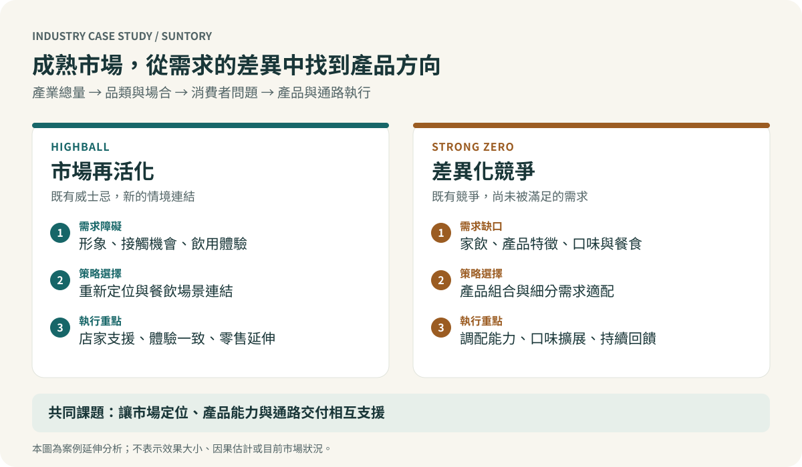

# Suntory: Product Strategy in a Mature Alcoholic Beverage Market

### Highball category revitalization and Strong Zero differentiation

[繁體中文](README.md) · [Full case study, Chinese](docs/case-study.zh-TW.md) · [Industry analysis, Chinese](docs/industry-analysis.zh-TW.md) · [Sources](docs/sources.md)

**How can a company find growth when its overall industry has limited growth?**

This historical case examines Suntory's Highball and Strong Zero strategies in Japan, primarily from the late 2000s to the early 2010s. It develops a Group 2 report for the Japanese Economy and Business Management course at National Cheng Kung University into a structured industry and management analysis.

The central argument is that mature markets can contain unmet needs at the level of occasions, experiences and customer segments. Highball and Strong Zero illustrate different responses to that opportunity.

## Two cases, different strategic problems

| Dimension | Highball | Strong Zero |
|---|---|---|
| Business problem | Whisky had become less relevant to younger adult consumers | A growing RTD category already contained established competitors |
| Strategic task | Reframe an existing way of drinking and make it accessible | Develop a relevant proposition within an existing competitive category |
| Customer lens | Meal occasions, familiarity, ease of ordering and consistent experience | At-home occasions, value perceptions, product attributes and taste preferences |
| Execution lens | Restaurant adoption, preparation support and subsequent retail access | Product formulation, flavor extensions and suitability with food |
| Management interpretation | Category revitalization | Differentiation and segment expansion |

These are analytical interpretations of historical evidence. They do not imply that Highball had no substitutes, that Suntory invented strong RTDs, or that any single product attribute caused market growth.

## Industry perspective

The analysis separates total industry demand from category performance. It also distinguishes restaurant partners, retail distribution and consumers: each affects whether a product proposition can become an actual purchase and repeat experience.

For Highball, the key management issue is the connection between positioning and delivery. Restaurant execution and experience consistency help explain why a familiar product can acquire new meaning. Suntory's historical account provides the underlying operational evidence. [Company account](https://www.suntory.co.jp/recruit/media/articles/000009.html?ke=hd)

For Strong Zero, the important question is what remained unmet after competitors had entered. Kirin's contemporary announcements establish that strong and zero-sugar RTD offerings already existed in 2008. The case therefore examines the combination of attributes and use occasions rather than claiming a unique invention. [Strong launch](https://www.kirinholdings.com/jp/newsroom/release/2008/0319_01.html) · [Portfolio announcement](https://www.kirinholdings.com/jp/newsroom/release/2008/0924b_01.html)

## Read the analysis

- [Full case study](docs/case-study.zh-TW.md): PEST, STP, marketing mix, comparison and management implications.
- [Industry analysis](docs/industry-analysis.zh-TW.md): category boundaries, competitive pressures, channels and capabilities.
- [Evidence review](docs/evidence-review.md): corrections to the original presentation and limits on interpretation.
- [Sources](docs/sources.md): public references and page-level mapping to the supplied materials.
- [Contribution and provenance](docs/contribution.md): team authorship and the scope of this edition.
- [Small historical dataset](data/README.md): definitions for the outlet chart and one company-reported growth indicator.

## Evidence and attribution

The original presentation is a jointly credited coursework artifact. This repository adds a rewritten narrative, original conceptual illustrations, source review and proposed evaluation questions. It does not claim sole authorship of the coursework, original consumer research, implementation at Suntory, or independently identified causal effects.

The source PDFs and third-party product images remain local. Historical company statements are identified as such. Product sugar claims are not treated as evidence of health benefits. The repository does not assess the current market or current product specifications. [Notice](NOTICE.md)
