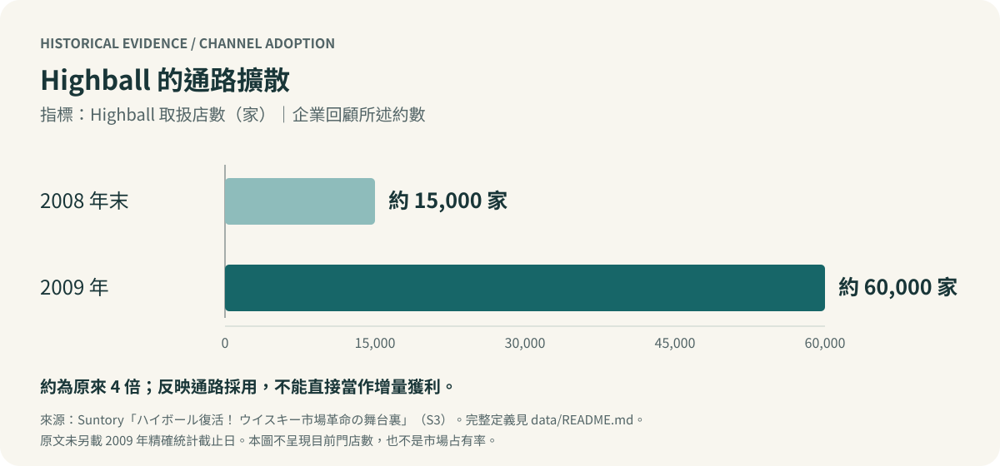

# Suntory：成熟酒類市場的產品開發與需求再造

### 從 Highball 的市場再活化，到 Strong Zero 的差異化競爭

[English](README.en.md) · [完整個案分析](docs/case-study.zh-TW.md) · [產業與競爭分析](docs/industry-analysis.zh-TW.md) · [證據審閱](docs/evidence-review.md) · [來源](docs/sources.md)

**當產業總量成長放緩，企業如何從既有產品與消費情境中找到新的成長空間？**

本專案以日本酒類產業為背景，整理國立成功大學「日本經濟與經營管理」課程的 Group 2 報告，分析 Suntory 在 2000 年代後期至 2010 年代前期的兩條產品策略：以 Highball 重新連結威士忌與年輕成年消費者，以及以 Strong Zero 在即飲酒類（RTD）市場中建立差異。

> **個案判斷：** 成熟市場的機會，可能藏在「尚未被滿足的使用情境」之中。Highball 改變消費者理解與接觸威士忌的方式；Strong Zero 則將既有技術、產品特徵與細分需求重新組合。兩者分別呈現市場再活化與競爭市場中的定位選擇。

## 個案分析的四個重點

| 分析問題 | 本案判斷 | 延伸閱讀 |
|---|---|---|
| 整體酒類市場低迷，是否代表所有品類都缺乏機會？ | 應分開觀察產業總量、品類變化與消費情境，不能用單一市場生命週期代替需求分析 | [產業結構](docs/industry-analysis.zh-TW.md) |
| Highball 為何值得重新嘗試？ | 舊有飲法在特定餐飲場域仍有吸引力；關鍵在定位、接觸機會與體驗的一致性 | [Highball 個案](docs/case-study.zh-TW.md#3-highball重新定義威士忌的飲用情境) |
| Strong Zero 如何面對先進入市場的競品？ | 結合糖類標示、果實感與家飲需求，再以口味與餐食搭配擴展細分市場；不能只用酒精濃度解釋差異 | [Strong Zero 個案](docs/case-study.zh-TW.md#4-strong-zero在既有競爭中尋找未滿足需求) |
| 策略如何落實成產品與通路決策？ | 把 STP 連結到產品設計、餐飲店執行、零售包裝與後續衡量 | [兩案比較與管理意涵](docs/case-study.zh-TW.md#5-兩案比較市場再活化與差異化競爭) |

## 從策略看到執行

Highball 的官方回顧指出，推廣初期曾出現口味不一致與店家嫌製作麻煩的問題。Suntory 隨後結合作業指引、設備、示範店與店家培訓，讓定位能在消費現場被體驗。[Suntory 當事人回顧](https://www.suntory.co.jp/recruit/media/articles/000009.html?ke=hd)

官方回顧所述的 Highball 取扱店數由 **2008 年末約 15,000 家，增加至 2009 年約 60,000 家**，約為原來的 4 倍。這是企業回顧中的通路擴散指標，不能單獨證明增量獲利或策略因果。[數據定義](data/README.md)

Strong Zero 的案例也顯示，競爭定位需要持續修正。Kirin 在 2008 年已推出 8% 的氷結 Strong；其同年資料亦提及糖類零系列。因此，Strong Zero 的差異化應從產品組合與情境適配分析，不能宣稱 Suntory 首創高酒精或糖類零 RTD。[Kirin 上市公告](https://www.kirinholdings.com/jp/newsroom/release/2008/0319_01.html) · [Kirin 系列說明](https://www.kirinholdings.com/jp/newsroom/release/2008/0924b_01.html)

## 內容與閱讀路線

1. [完整個案分析](docs/case-study.zh-TW.md)：經營問題、PEST、兩項產品策略、行銷組合、取捨與結論。
2. [產業與競爭分析](docs/industry-analysis.zh-TW.md)：品類競爭、價值鏈、通路角色與企業能力。
3. [證據審閱與原稿修訂](docs/evidence-review.md)：時點、標示、競爭範圍及不能直接成立的結論。
4. [資料來源與頁碼對照](docs/sources.md)：課程材料、公開第一手資料及引用位置。
5. [成果與貢獻說明](docs/contribution.md)：小組報告、本次整理與外部研究的區分。

## 專案定位

這是一份**歷史個案的公開整理與延伸分析**。PEST、STP 與市場再活化來自課程材料；產業競爭映射、策略取捨及驗證設計為本次整理。沒有自行執行消費者調查，也沒有取得企業內部銷售、成本或實驗資料。

原始簡報與閱讀材料保留於本機。公開版本採用重新撰寫的分析、原創示意圖與少量有來源的彙總資料。Strong Zero 的糖類標示屬產品定位資料，不能寫成健康功效。[使用與歸屬聲明](NOTICE.md)
